# RIFT Artillery — 0.4.0

Пошаговая артиллерия для **Android и Windows / Unity**. 12 больших разрушаемых карт, 120 видов оружия и инструментов, семь рас, четыре босса и 16 музыкальных тем. Дуэль с ИИ, игра вдвоём на одном устройстве, канатная гонка. Русский интерфейс, офлайн, без рекламы и доната; магазин работает за материалы из боёв.

**[Android APK](dist/RIFT-Artillery-0.4.0.apk)** · **[Windows ZIP](dist/RIFT-Artillery-Windows-0.4.0.zip)** · [Android AAB](dist/RIFT-Artillery-0.4.0.aab) · [Unity-проект](unity) · [Каталог](docs/CONTENT.md) · [Проверки](docs/QA-0.4.0.md)

Контент версии **0.3.0**, включённый в 0.4.0: 40 новых предметов, четыре новые карты, реактивная доска, точная настройка прицела и выбор музыки. Исправлено сдвигание соседних бойцов при ходьбе; аптечка и телепорт больше не завершают ход.

Ниже — кадры Android и Unity-клиента для Windows. Новые кадры 0.4.0 сняты после проверок. Галереи прежних карт и оружия сохраняют изображения контента 0.3.0. Нажмите на изображение, чтобы открыть его в полном размере.

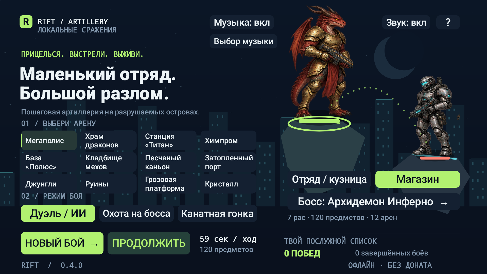

*Меню Android: выбор карты, режима и командира перед новым боем.*

## Новое в 0.4.0

**20 новых предметов:** «Игла», рикошетная сфера, «Саламандра», кислотная игла, ледяной веер, громовая сфера, сингулярность, лечебная граната, зеркальный лазер, штурмовая и антиматериальная винтовки, автодробовик, шрапнельная пушка, дуговой излучатель, лазерный резак, звено дронов, щитовой маяк, баррикада, медицинский тотем и Тесла-турель.

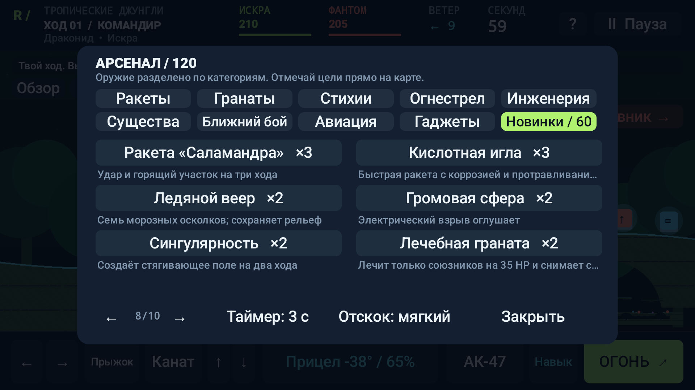

Зеркальный лазер отражается от рельефа дважды; ледяной веер выпускает семь морозных осколков; лечебная граната лечит союзников, сохраняя землю; сингулярность стягивает бойцов; дроны сбрасывают пять бомб на выбранный участок. [Все параметры](docs/CONTENT.md).

## Магазин и склад

Кнопка **«Магазин»** находится в главном меню Android и Windows. В магазине 14 наборов боеприпасов и снабжения и пять покупаемых аур. Цена, состав и количество на складе видны перед покупкой. Начальный баланс — 150 материалов. Победа приносит 60, победа над боссом — 180, поражение — 20, ничья — 30. Кузница использует тот же кошелёк.

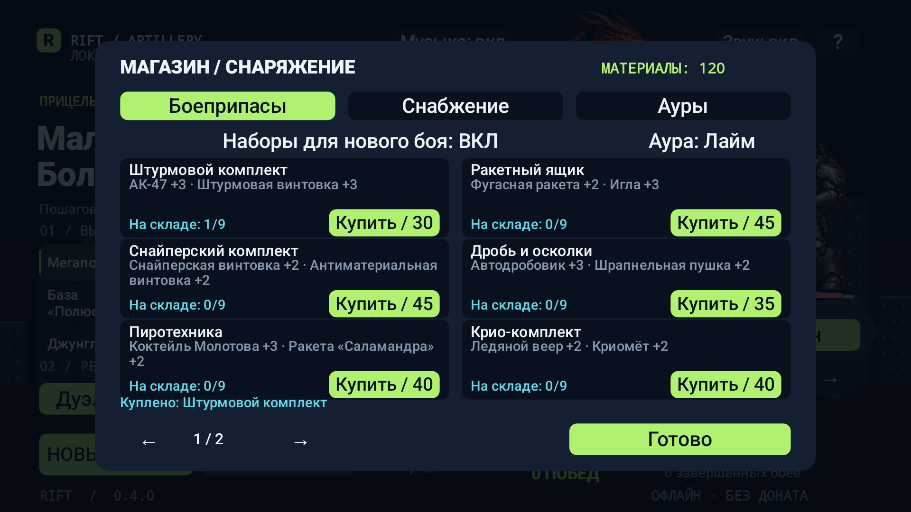

Каждый новый бой расходует **по одному набору каждого купленного типа**, добавляя указанные боеприпасы каждому бойцу игрока. Склад вмещает до девяти наборов одного типа. В дуэли вдвоём бонус получают оба отряда. В канатной гонке наборы не расходуются. Продолжение сохранённой партии тоже не расходует склад. Автоприменение можно выключить в магазине.

Ауры покупаются один раз, свободно переключаются и меняют цвет кольца под бойцами. Они не усиливают урон или здоровье. Покупки, склад, выбранная аура и выключатель наборов сохраняются локально; реальные деньги и интернет не нужны.

<details>
<summary>Магазин Windows и косметические ауры</summary>

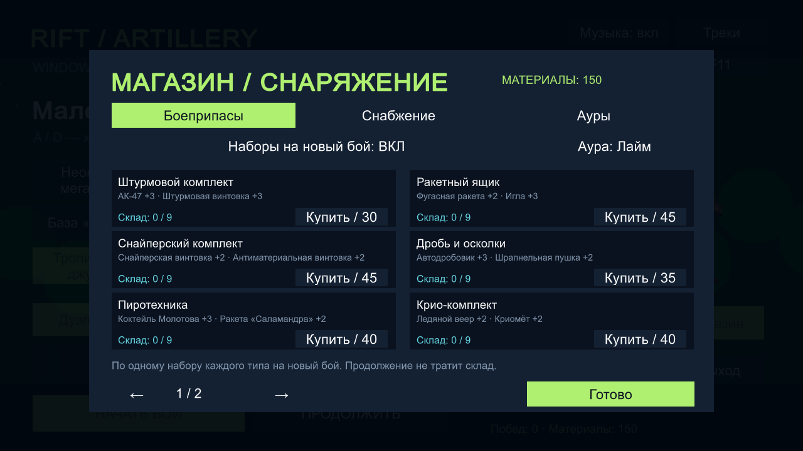

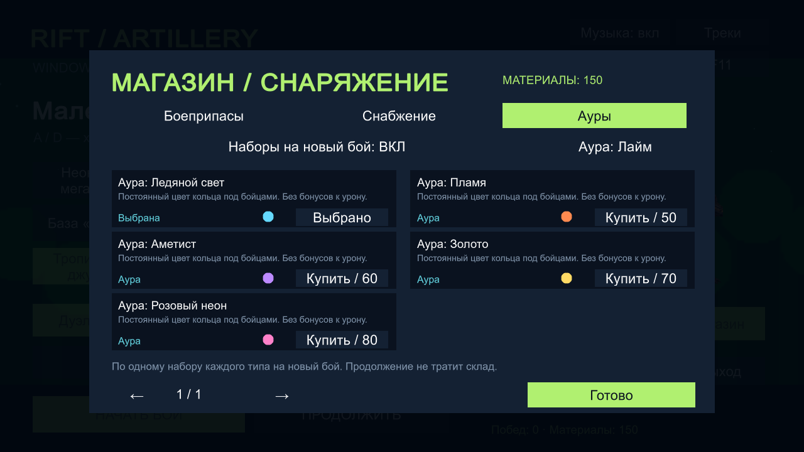

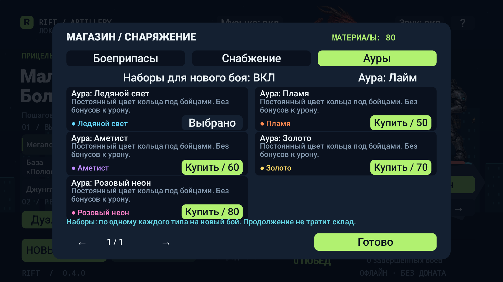

</details>

## Интерактивные карты

На каждом новом боевом уровне размещены девять объектов восьми типов. Подойдите на расстояние до 110 пикселей: в Android появится кнопка **«Использовать»**, в Windows — кнопка и клавиша **F**. Активация сохраняет атаку и не пополняет время хода. Объекты отмечены на миникарте; цвет помогает отличить их назначение.

| Объект | Действие |
|---|---|
| Ящик снабжения | Одноразово выдаёт аптечку, три гранаты и две ракеты «Игла» |
| Ящик боеприпасов | Два заряда выбранного оружия; для бесконечной базуки — два заряда штурмовой винтовки |
| Аптечная станция | +30 HP и снятие статусов, три использования, перерыв 3 секунды; полное здоровье не тратит заряд |
| Трамплин | Сильный подброс с готовым парашютом; перерыв 2,5 секунды |
| Переключатель моста | Создаёт или убирает мост через центральный разлом |
| Парные порталы | Переносят к другому порталу; оба блокируются на 3 секунды, занятый выход не допускает перенос |
| Кислотная бочка | Разрушается выстрелом, взрывается и оставляет коррозию |
| Электробочка | Разрушается выстрелом и оглушает электрическим взрывом |

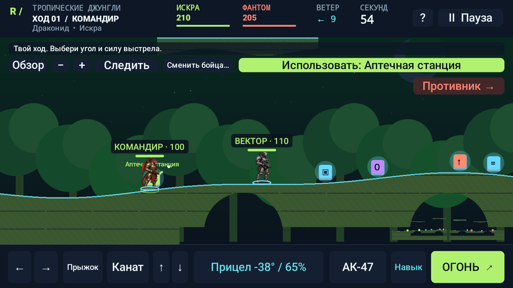

<details>
<summary>Трамплин и портал в Android</summary>

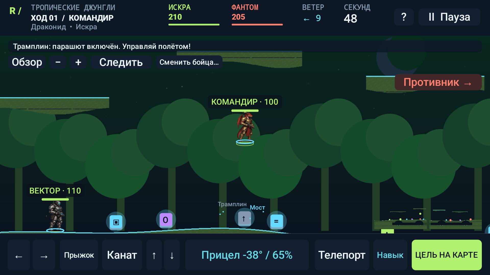

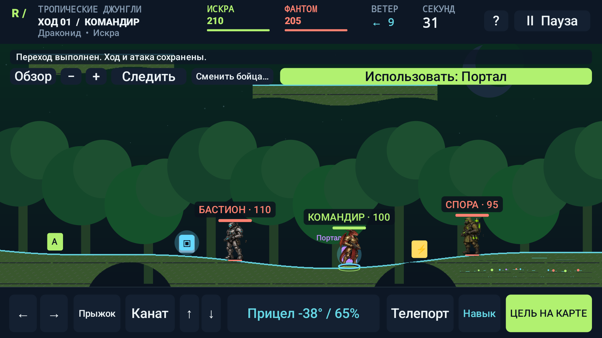

</details>

Медицинский тотем и Тесла-турель из арсенала позволяют добавить устройства во время боя. Тотем содержит три заряда лечения; турель атакует видимого противника в пределах 800 пикселей и работает четыре перехода хода. Состояние устройств, кулдауны, использованные ящики и изменённый мост сохраняются вместе с партией. Старые партии сохраняют прежний набор объектов: для новой интерактивной карты начните новый бой.

## Управление и исправления 0.3.1

- **Свободный проход через бойцов:** союзники и противники больше не перекрывают путь при ходьбе и не сдвигаются за персонажем. Можно остановиться рядом или пройти обратно без прыжка.
- **Управление Windows:** A / D и стрелки ← / →, клавиши с русской раскладкой, прицеливание мышью или ↑ / ↓, сила колесом или + / −. Открытые окна блокируют управление под собой.
- **Звук Windows:** восстановлен вывод музыки через AudioListener; в окне музыки есть громкость и выключатель. Проверяется сигнал на выходе микшера.
- **Полный экран:** F11, Alt+Enter или кнопка в главном меню и на паузе. Повторное нажатие возвращает оконный режим.

## Управление боем

- **Ходьба не таскает соседнего бойца.** Персонажи проходят друг через друга у земли. Столкновения с рельефом, отбрасывание взрывами и возможность встать сверху на другого бойца сохранены.
- **Новый прицел:** крупная панель с длинными ползунками, шагом 1° и 5°, разворотом и настройкой силы. Касание поля задаёт направление; дальнейшее движение пальца по горизонтали точно меняет угол, по вертикали — силу. Выстрел выполняется отдельно.
- **Телепорт и аптечка сохраняют ход и основную атаку.** Расходуется только запас предмета, время не пополняется. Недопустимая точка и ненужное лечение не тратят предмет.
- На ход даётся **59 секунд**, после атаки — три секунды на отход. Одна бесплатная смена союзника до атаки сохраняет время. Арсенал и точный прицел приостанавливают бой.

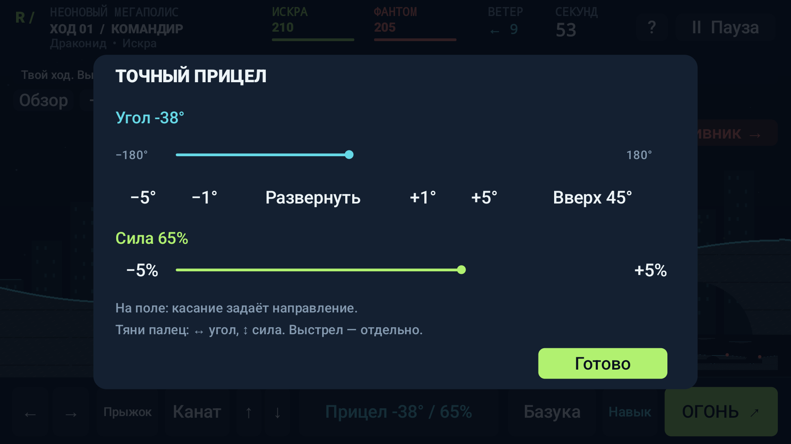

*Длинные ползунки угла и силы, пошаговая поправка и разворот направления. Пока панель открыта, бой приостановлен.*

## 120 видов оружия и инструментов

В арсенале **120 предметов**, включая 20 новых в 0.4.0. Кнопка «Новинки / 60» в Android показывает последние 60 предметов отдельно. В компьютерном арсенале есть поиск по названию. Параметры и запасы всех предметов — в [каталоге](docs/CONTENT.md).

| Группа | Примеры и поведение |
|---|---|
| Ракеты | Фугасная с большим кратером, термобарическая, рикошетная, буровая, трёхствольная, рой самонаводящихся и разделяющаяся ракета |
| Бомбы и гранаты | Арбузобомба с восемью дольками, ананасовая, тыквенная, осколочная с 12 зарядами, фейерверк, дымовая, ЭМИ и вампирская |
| Стихии | Коктейль Молотова, обычный и тяжёлый огнемёты, криомёт, кислотная, ледяная и огненная кассеты, цепная молния |
| Огнестрел | Миниган, дробовик, снайперка, АК-47, лазер, плазменная винтовка, рельсотрон, Гаусс, парные пистолеты, арбалет, гвоздомёт и звуковая пушка |
| Авиация | Авиаудар, напалм, метеориты, ковровая бомбардировка и объёмный авиаудар |
| Инструменты | Канат с автоподтяжкой, управляемый бур, защитник, силовой купол, балка, телепорт, ранец, парашют и реактивная доска |

[Арсенал предыдущего выпуска](docs/screenshots/v030-android-07-new-arsenal.png).

*Вкладка «Новинки / 60» собирает добавленные предметы отдельно от остальных категорий.*

<details>
<summary>Арбузобомба, коктейль Молотова и огнемёты</summary>

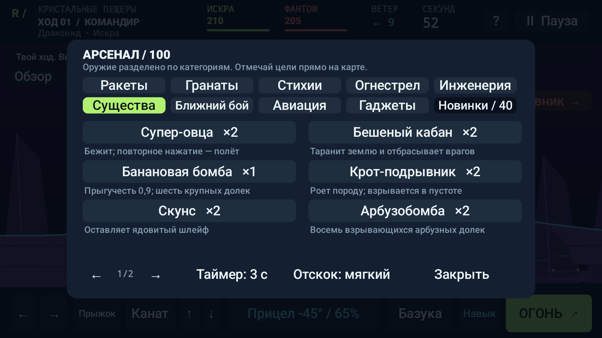

*Арбузобомба распадается на восемь взрывающихся долек. В арсенале видны запас и описание предмета.*

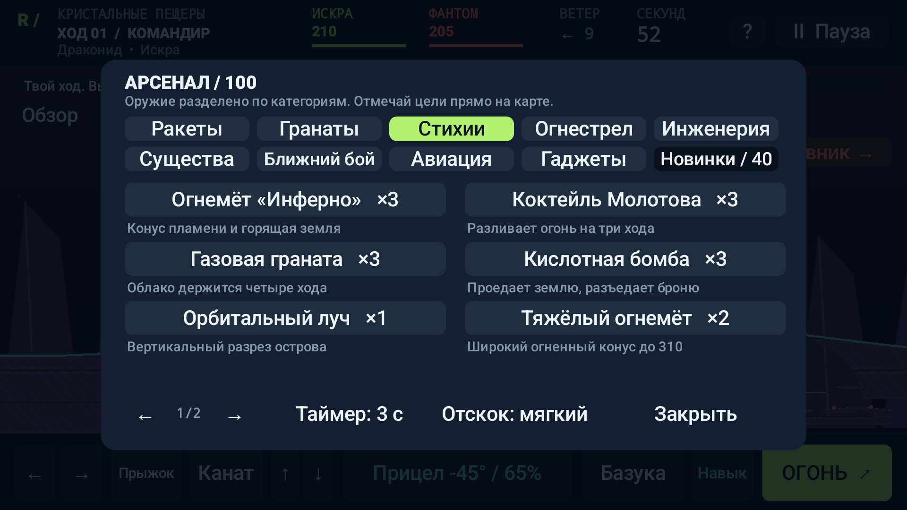

*Категория стихий: оружие с огнём и другими эффектами. Коктейль бросается по траектории, огнемёты поражают область перед бойцом.*

</details>

**Реактивная доска** даёт 160 топлива, горизонтальный полёт, подъём, снижение и безопасную посадку. Включается до основной атаки. На Android удерживайте ↑ / ↓ и ← / →, в Windows — W / S и A / D. Доска и топливо сохраняются вместе с партией.


*Полёт над рельефом: оставшееся топливо отображается рядом с бойцом.*

Бур прорезает землю в направлении прицела при удержании движения. Защитник поглощает до 40 урона и действует два перехода хода. Мины, турели, статусы, иммунитеты, экипировка и локальная кузница доступны на обеих платформах.

## 12 больших карт

Мир 2880×1440: проходимая поверхность, верхние платформы, тоннели, мосты и опасная нижняя граница. Камера поддерживает сопровождение, обзор, ручное перемещение, миникарту и масштабирование.

К мегаполису, храму драконов, орбитальной станции, химзаводу, арктической базе, кладбищу мехов, каньону и порту добавлены:

| Карта | Особенности |
|---|---|
| Тропические джунгли | Заросшие тоннели, кроны деревьев и широкие уступы |
| Забытые руины | Каменные террасы, древние своды и мост |
| Грозовая платформа | Подвесные палубы и пониженная гравитация |
| Кристальные пещеры | Светящиеся гроты и более лёгкая гравитация |


*Джунгли: поверхность для передвижения и подземные проходы. Миникарта помогает найти бойцов на большой арене.*

<details>
<summary>Ещё три новые карты: руины, гроза и кристаллы</summary>

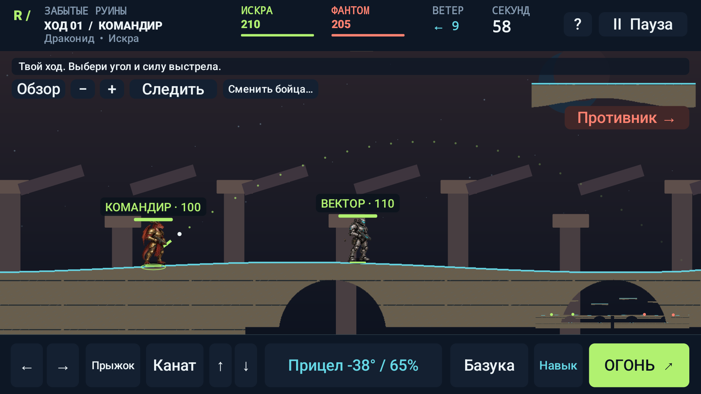

*Забытые руины: каменные террасы, своды и мост между участками карты.*

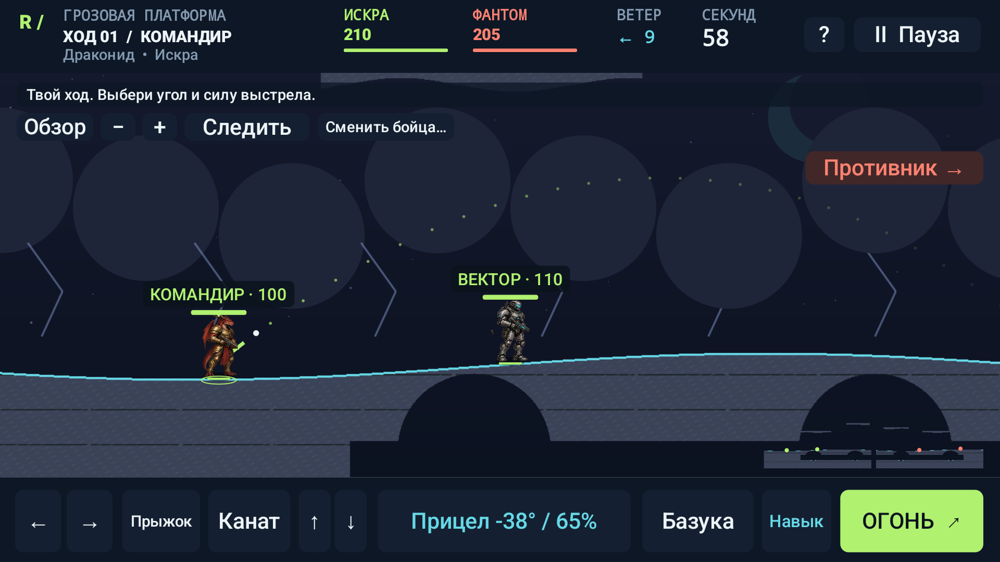

*Грозовая платформа: подвесные палубы; пониженная гравитация меняет прыжки и траектории.*

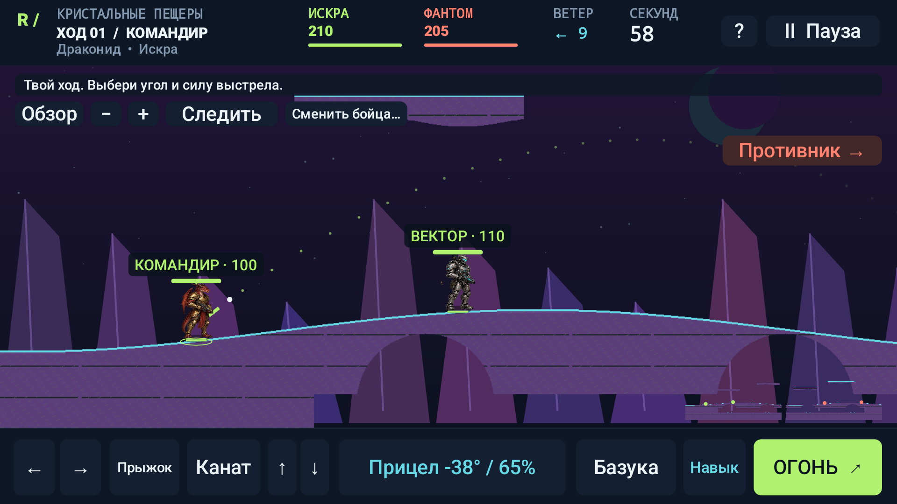

*Кристальные пещеры: светящиеся гроты, уступы и проходы в разрушаемой земле.*

</details>

Семь рас командира: драконид, киборг, мутант, демон, наёмник, нежить и фантом. У каждой есть характеристики, иммунитеты и разовый навык. Боссы — Инферно, Алхимик, Фафнир и Генерал; три фазы, предупреждения и собственные рисунки. Генерала защищают разрушаемые генераторы.

## 16 треков и выбор музыки

«Выбор музыки» доступен в меню и на паузе. **«По локации»** включает тему карты. Можно выбрать любой трек вручную; он продолжит играть после смены локации. Есть переход к предыдущему и следующему треку, сохранение выбора и отдельное выключение музыки и эффектов.

В музыкальном окне с паузы можно прослушать композицию; закрытие окна возвращает остановленное воспроизведение. [Все темы и исходные композиции](docs/MUSIC.md).

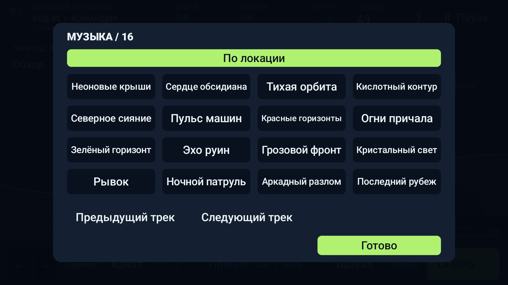

*12 тем локаций и четыре дополнительные композиции: «Рывок», «Ночной патруль», «Аркадный разлом», «Последний рубеж».*

## Отдельная компьютерная версия на Unity

Скачайте [Windows ZIP](dist/RIFT-Artillery-Windows-0.4.0.zip), **распакуйте всю папку** и запустите `RIFT-Artillery.exe`. Для готовой игры не нужно устанавливать Unity, Java или подключаться к интернету. Один EXE без остальных файлов не работает.

Unity-клиент использует ту же симуляцию, что и Android: 120 предметов, 12 карт, расы, боссы, ИИ, гонка, разрушения и сохранения. Кузница, награды и настройки хранятся локально. Формат партии общий; автоматической синхронизации между устройствами нет.

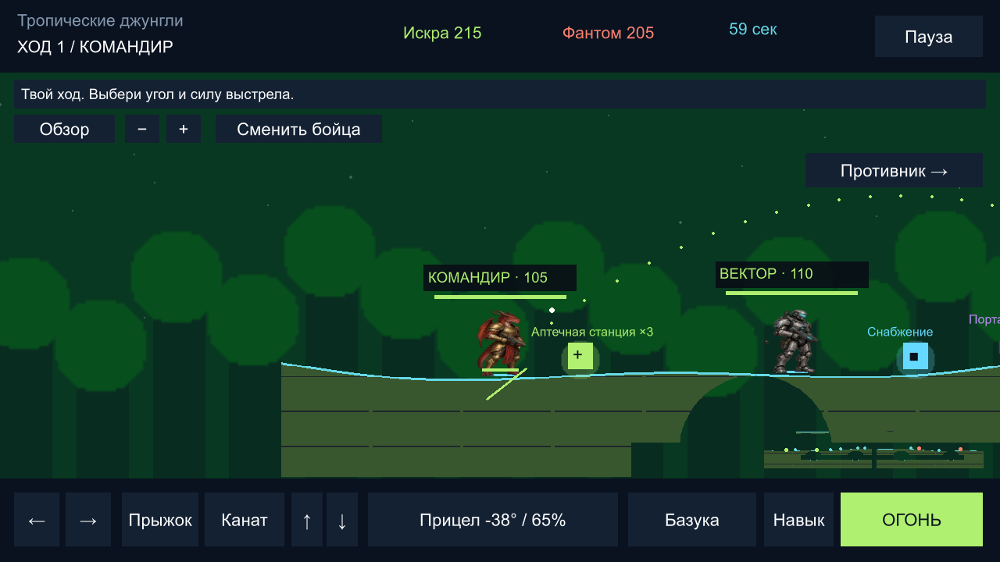

*Windows, 1280×720: бой на общей с Android симуляции, управление мышью и клавиатурой.*

| Действие | Windows |
|---|---|
| Ходьба / прыжок | A / D или ← / →, пробел |
| Направление / сила | Щелчок и перетаскивание мышью или ↑ / ↓; колесо или + / − |
| Выстрел | Enter или «ОГОНЬ»; для предмета с точкой — щелчок по карте |
| Канат / полёт | Q — канат, W / S — трос или тяга |
| Навык / союзник / арсенал | E / Tab / R |
| Камера / масштаб | Правая кнопка с перетаскиванием, Shift + колесо |
| Пауза | Esc |
| Объект рядом | F или кнопка в верхней панели |
| Полный экран / окно | F11, Alt+Enter или кнопка в меню |

[Открыть и собрать Unity-проект](docs/UNITY.md).

<details>
<summary>Галерея Windows: меню, прицел, поиск оружия и музыка</summary>

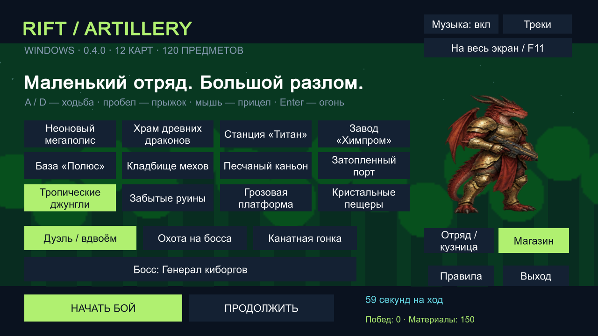

*Windows 0.4.0: выбор локации, режима и командира; справа сверху — кнопка полноэкранного режима.*

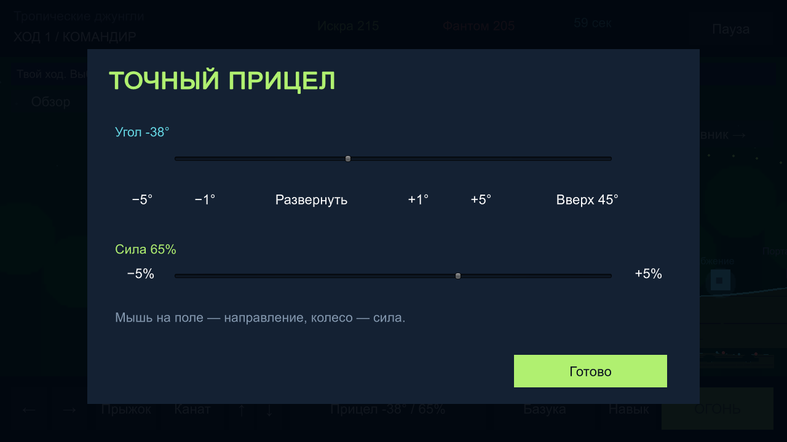

*Точный угол и сила выстрела доступны в отдельной панели.*

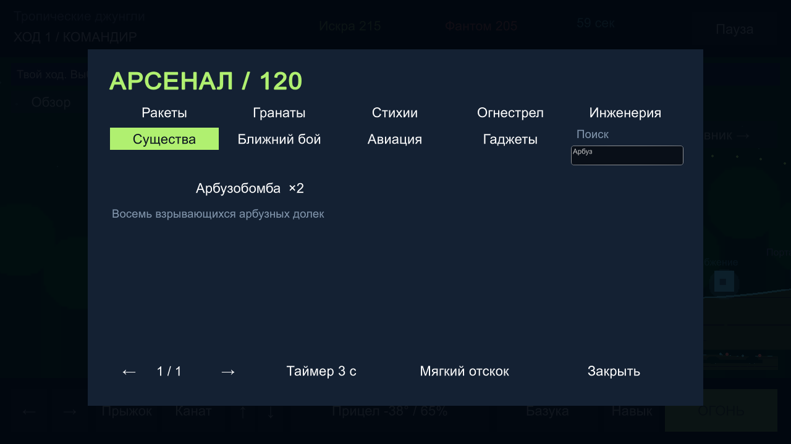

*Поиск по названию помогает выбрать нужный предмет среди 120 видов оружия и инструментов.*

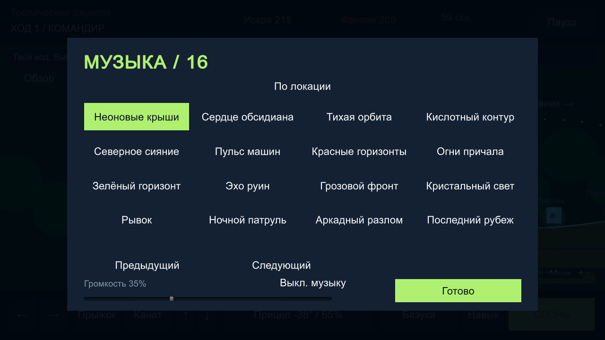

*Windows 0.4.0: 16 тем, ручной выбор, выключатель и ползунок громкости. Вывод музыки проверен на аудиомикшере.*

</details>

## Установка Android и обновление

Android 8.0 и новее, альбомная ориентация. Откройте подписанный [APK](dist/RIFT-Artillery-0.4.0.apk). Выпуск 0.4.0 устанавливается поверх подписанной 0.3.1 с сохранением партии. Прежние 100 предметов сохраняют свои номера; 20 новых получают стартовый запас при загрузке. Формат v4 читает v1/v2/v3; новое оружие получает начальный запас при загрузке старой партии.

Сохранённый бой хранит свою землю. **Для новой карты выберите «НОВЫЙ БОЙ».** Остаток старого хода сохраняется; новые ходы длятся 59 секунд. Версия 0.1 использовала другой сертификат и требует переустановки.

<details>
<summary>Интерфейс на Android-планшете</summary>

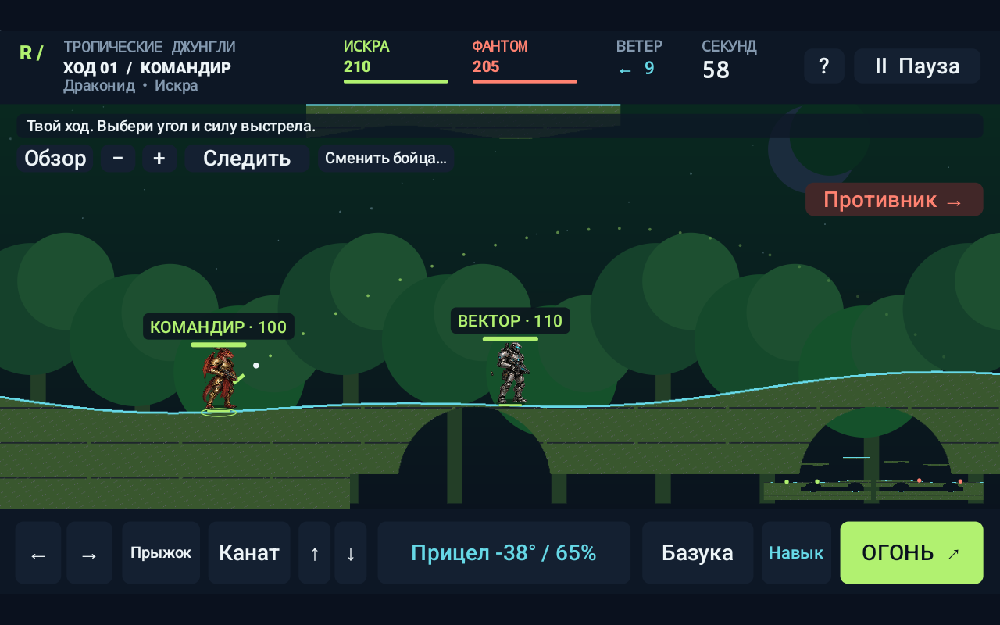

*Планшет, 1280×800: сенсорные кнопки движения, прыжка и каната, панель выстрела и миникарта.*

</details>

## Проверено перед финальными кадрами

**106 тестов механик, 7 тестов связи с Unity, по 196 проверок Android на телефоне и планшете и 206 проверок Windows-плеера.** Проверены прицел, столкновения, лечение и телепорт без потери атаки, полёт, оружие, боссы, сохранения и воспроизведение всех 16 треков. Android Lint: debug и release без ошибок; три рекомендации относятся к синхронному сохранению магазина.

Кадры каждой платформы сняты после проверок её сборки. [Отчёт 0.4.0](docs/QA-0.4.0.md), [кадры 0.3.0](docs/screenshots/manifest-v030.json) и [обновлённые кадры 0.4.0](docs/screenshots/manifest-v040.json), [контрольные суммы](dist/SHA256SUMS.txt). Стабильные 60 FPS и испытания на физических телефонах не заявляются.

Исходные PNG доступны в [папке скриншотов](docs/screenshots). Манифесты содержат время съёмки, размеры и SHA256 кадров и соответствующих сборок.

## Сборка из исходников

JDK 17, Android SDK 35 / Build Tools 34.0.0. Для Windows — Unity 6000.0.77f1 с Windows Build Support. Gradle Wrapper включён.

```powershell
. .\tools\Prepare-BuildEnvironment.ps1
.\gradlew.bat :core:test :desktop-core:test :app:assembleDebug :app:assembleDebugAndroidTest :app:lintDebug
.\tools\Test-Android.ps1 -Adb "$env:ANDROID_HOME\platform-tools\adb.exe" -Serial emulator-5558
.\tools\Build-Release.ps1
.\tools\Build-Unity.ps1 -Package
```

Подготовка окружения создаёт локальный агент совместимости Java с Windows, где недоступен AF_UNIX loopback. Он используется только для сборки, не входит в игру и хранится в игнорируемой `.tmp`.

Ключ Android и защищённый Windows-пароль остаются в локальной `.private`. Для независимого проекта новый ключ создаётся `Build-Release.ps1 -CreateLocalKey`; для обновления приложения нужен прежний ключ. Ключи и пароли не публикуются.

`core` — общая симуляция; `app` — Android Canvas; `desktop-core` — локальный движок Unity; `unity` — отдельный проект C#. [Атласы](docs/ART_ASSETS.md), [план развития](docs/PRODUCTION_PLAN.md).

Офлайн-выпуск: сетевые матчи, серверные аккаунты, онлайн-кооператив, рейтинги и редактор карт не реализованы; публикация в магазине не выполнена. Численное совпадение всех правил с Wormix не заявляется.
