# RIFT / Artillery — 0.2.1

Пошаговая артиллерия для Android: большие разрушаемые острова, семь рас, 57 видов оружия и инструментов, четыре босса. Бой с ИИ, игра вдвоём на одном устройстве и испытание каната. Русский интерфейс, без интернета, рекламы и покупок.

**[Установить подписанный APK](dist/RIFT-Artillery-0.2.1.apk)** · [AAB](dist/RIFT-Artillery-0.2.1.aab) · [Каталог контента](docs/CONTENT.md) · [Проверки](docs/QA-0.2.1.md) · [План выпуска](docs/PRODUCTION_PLAN.md)

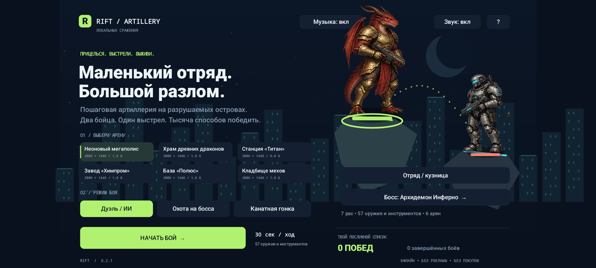

## Музыка локаций

В 0.2.1 каждая из шести карт получила свою оригинальную зацикленную тему: синтвейв города, барабаны вулкана, космический эмбиент, электронный химзавод, арктические колокольчики и индустриальное кладбище мехов. [Все темы, длительности и исходные записи](docs/MUSIC.md).

Выбор карты меняет музыку уже в меню. Музыка и звуковые эффекты выключаются отдельно; оба переключателя есть в меню и на паузе. Пауза и сворачивание останавливают трек, продолжение возвращает воспроизведение. Настройка сохраняется после закрытия приложения.

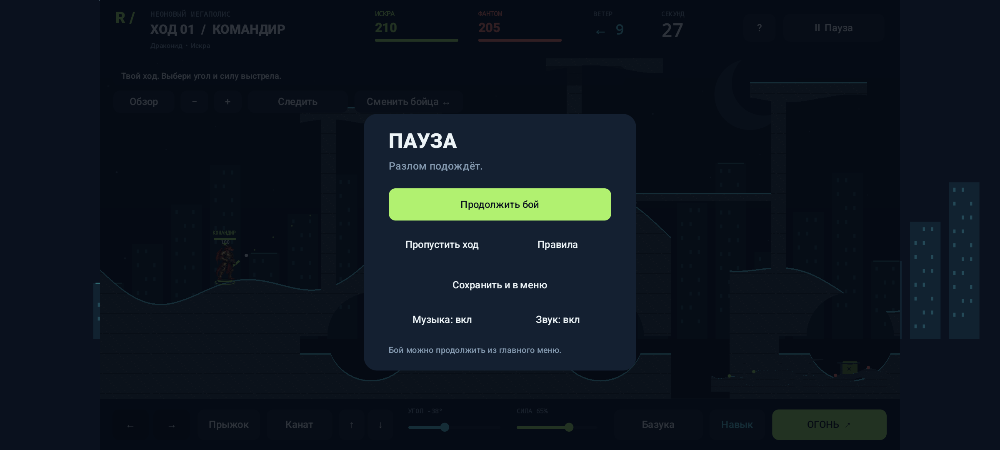

## Установка

Android 8.0 и новее, альбомная ориентация. Перенесите APK на устройство и откройте его для установки. Для игры не нужен аккаунт. APK и AAB подписаны локальным ключом выпуска; это офлайн-сборка, ещё не опубликованная в магазине.

```powershell
adb install -r dist/RIFT-Artillery-0.2.1.apk
adb shell am start -n com.riftartillery.game/.MainActivity
```

Предыдущий APK 0.1 подписан отладочным ключом. Для перехода на новый ключ потребуется удалить старое приложение; его локальные данные при удалении теряются. Сам формат сохранения 0.1 поддерживается загрузчиком 0.2. Контрольные суммы: [SHA256SUMS.txt](dist/SHA256SUMS.txt).

## Что добавлено

- Шесть арен размером **2880 × 1440**, вдвое шире прежних: мегаполис, вулканический храм, орбитальные острова, химзавод, арктическая база и кладбище мехов. Платформы, тоннели, мосты, разная гравитация и опасности окружения.
- Реалистичнее нарисованные герои: драконид, киборг, мутант, демон, наёмник, нежить и фантом. Выбор расы командира, шлема, артефакта и модификации базуки.
- Миниган, дробовик с двумя выстрелами, снайперская винтовка, АК-47, лазер, репульсор, газовое облако, Тесла, огнемёт, управляемые существа и авиация. Полный [каталог всех 57 предметов](docs/CONTENT.md).
- **Управляемый бур:** включите его, задайте направление прицелом и удерживайте движение — боец прорежет тоннель в земле. Запас топлива виден на экране.
- **Защитник:** сопровождающий дрон поглощает до 40 урона и действует два перехода хода. Есть силовой купол, балка, мины, турель, ранец, парашют, усиленный прицел и телекинез.
- **Смена своего бойца:** одна бесплатная смена до атаки, без сброса таймера. Предмет «Смена персонажа» даёт дополнительные переключения. После начала атаки смена закрыта.
- Четыре босса с тремя фазами, предупреждениями атак и отдельными рисунками. Генерала защищают два разрушаемых генератора.
- Испытание каната с пятью контрольными точками; канат огибает углы, позволяет раскачиваться и менять длину.
- Газ, огонь, заморозка, оглушение, кровотечение и коррозия. Расовые иммунитеты, лечение мутанта газом и уничтожаемое надгробие нежити перед возрождением.
- Локальная кузница: материалы за победы, постоянные открытия экипировки. Пауза, реванш, продолжение боя и восстановление после перезапуска приложения.

Пояс сапёра из кузницы показывает опасную зону вражеских мин и мин-пауков. Эффект зависит от экипировки текущего бойца.

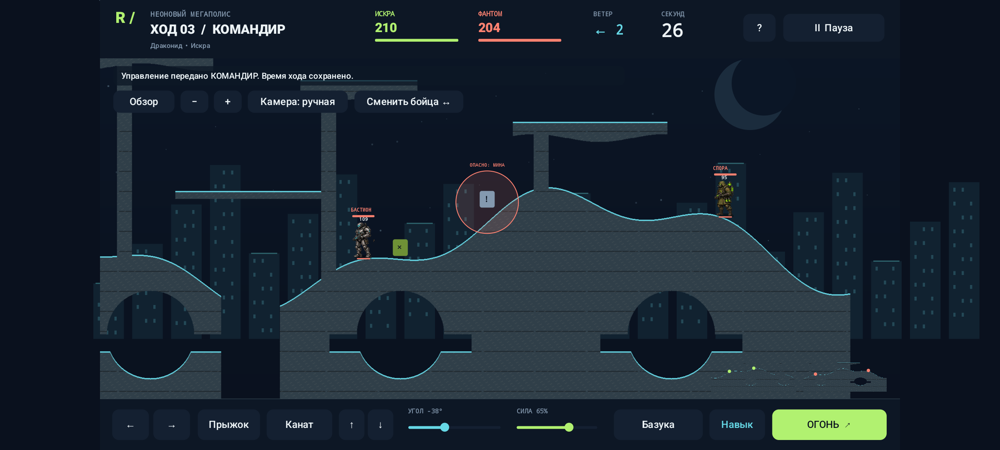

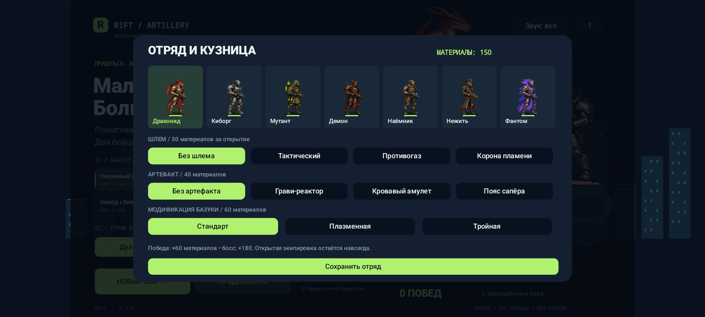

Выберите расу командира и экипировку в кузнице. Второй союзник — киборг; противники и состав босса задаются режимом. Активный расовый навык доступен один раз за бой.

## Большие карты и камера

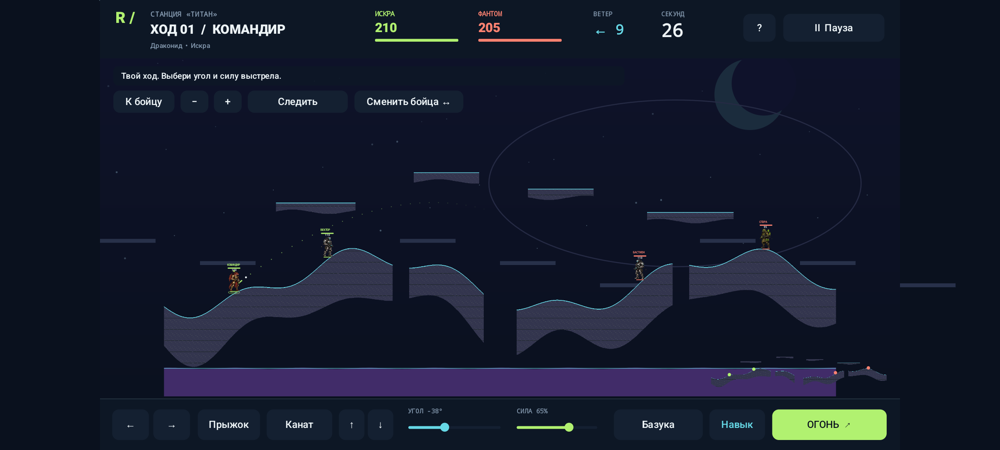

«Обзор» показывает весь остров, «К бойцу» возвращает сопровождение. Масштаб меняется кнопками или двумя пальцами. В режиме «Камера: ручная» перетаскивайте поле; касание миникарты переносит обзор в нужный сектор. На орбите — отдельные парящие острова и пониженная гравитация.

## Арсенал и инструменты

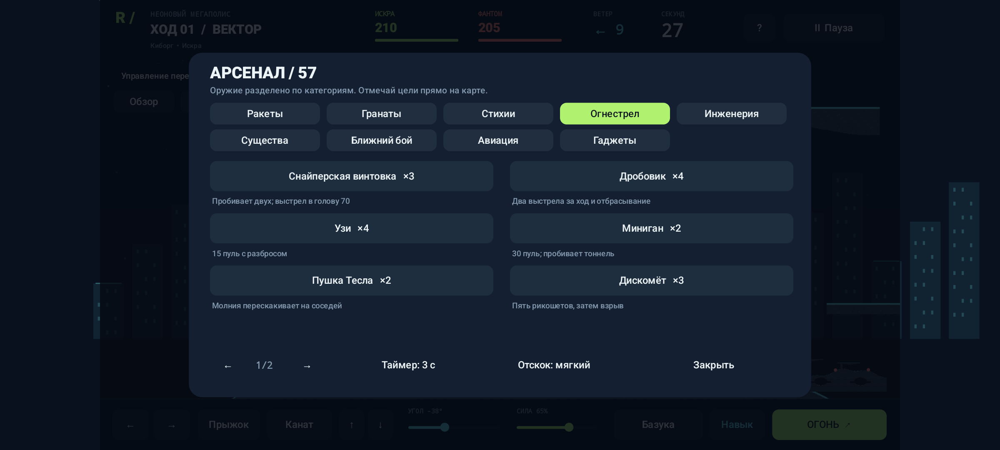

Арсенал разделён на девять категорий. На странице до шести предметов; стрелки переключают страницы. Для гранат отдельно настраиваются таймер и отскок.

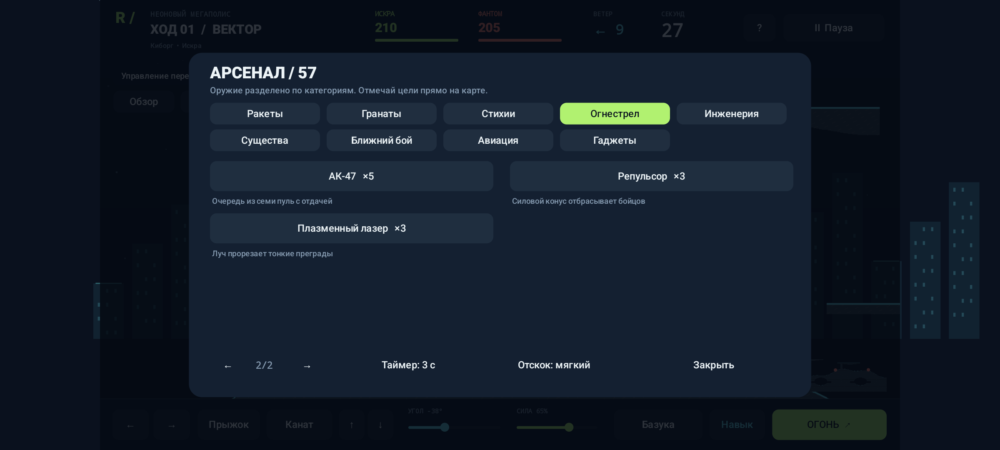

АК-47 стреляет очередью из семи пуль; репульсор отбрасывает бойцов силовым конусом; лазер прорезает тонкие преграды. Запасы и способы применения отличаются.

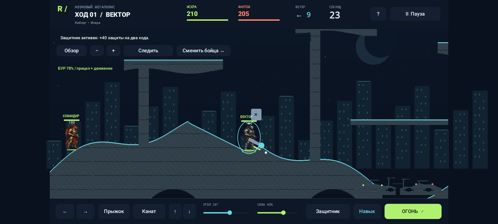

Бур и защитник используются до основного выстрела. Переключение между союзниками сохраняет оставшееся время команды. Новое время появляется при переходе хода к другой команде.

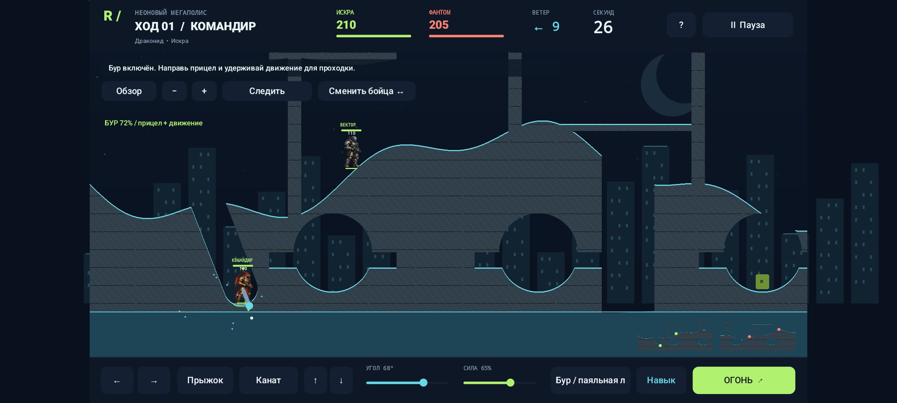

Прицел вниз позволяет проложить шахту до подземных ходов. Следите за топливом и нижней опасной границей карты.

## Боссы

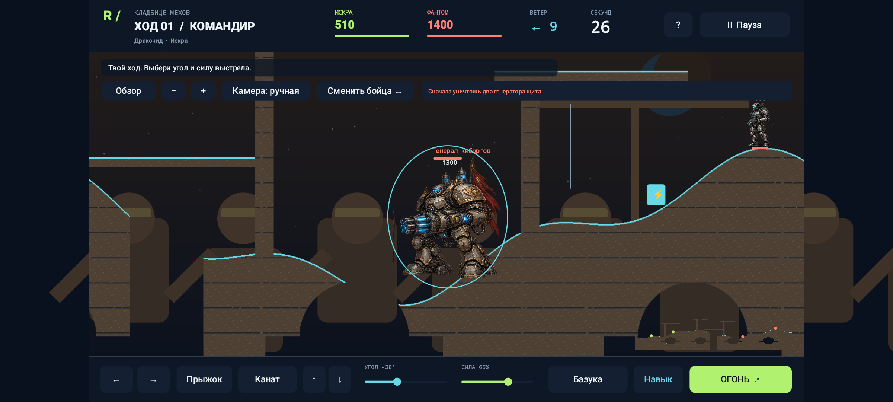

Инферно вызывает метеоры, Алхимик чередует газ и кислоту, Фафнир атакует огнём и порывами ветра, Генерал применяет авиацию, плазму и турели. При потере здоровья поведение меняется; уничтожение генераторов снимает защиту Генерала.

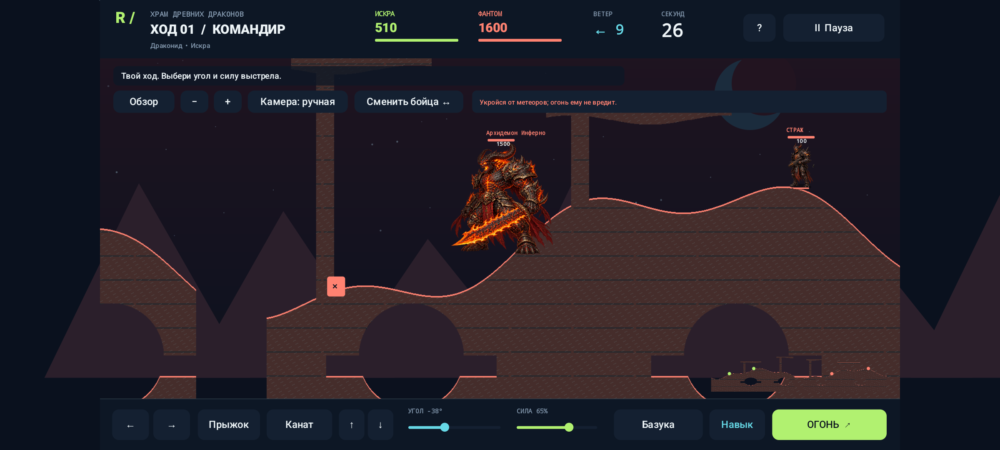

## Управление

| Действие | Управление |
|---|---|
| Ходьба | Удерживать ← / → |
| Прыжок | «Прыжок» на опоре |
| Прицел | Коснуться поля или двигать ползунок угла |
| Мощность | Ползунок «Сила» |
| Выбор предмета | Кнопка текущего оружия внизу |
| Обычный выстрел / инструмент | «ОГОНЬ» |
| Предмет с выбором точки | После выбора коснуться нужного места на карте |
| Смена союзника | «Сменить бойца ↔» до атаки |
| Бурение | Включить бур, задать угол, удерживать движение |
| Канат | Прицелиться в опору, «Канат»; ↑ / ↓ меняют длину |
| Реактивный ранец | Включить в арсенале; ↑ — тяга, ← / → — движение |
| Полёт супер-овцы | Повторно нажать огонь; управлять направлением |
| Пауза / сохранение | «II Пауза» → «Сохранить и в меню» |

На ход даётся 30 секунд, после выстрела — три секунды для отхода одновременно с полётом снаряда. Арсенал, справка и пауза останавливают бой. У дробовика два выстрела на одну единицу запаса.

## Проверено перед скриншотами

**58 тестов логики. По 74 сценария интерфейса прошли на трёх профилях:** Android 8, широкий экран Android 15 и планшетный формат Android 15. К прежним игровым сценариям добавлены 20 проверок музыки. Проверены мультитач, камера, бурение, защитник, переключение бойцов, атаки всех боссов, пауза и сохранения. Android Lint для debug и release: замечаний нет.

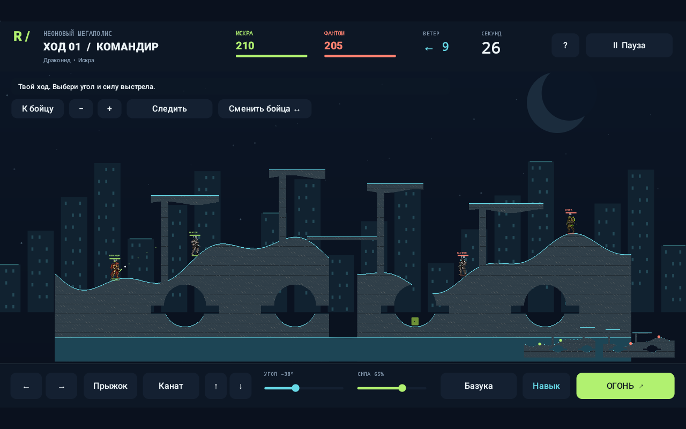

Новые кадры `v021` сняты из подписанного APK 0.2.1 после тестов; галерея `v02` показывает игровой контент проверенной версии 0.2.0. [Отчёт QA](docs/QA-0.2.1.md) содержит исходные результаты, размеры доступной области экрана и измерения кадров. Проверки выполнены на эмуляторах; стабильные 60 FPS на физических телефонах не подтверждены.

## Сборка из исходников

Нужны JDK 17, Android SDK 35 и Build Tools 34.0.0. Gradle Wrapper включён в проект.

```powershell
.\gradlew.bat :core:test :app:assembleDebug :app:assembleDebugAndroidTest :app:lintDebug
.\tools\Test-Android.ps1 -Adb "$env:ANDROID_HOME\platform-tools\adb.exe" -Serial emulator-5554
.\tools\Build-Release.ps1
```

`Build-Release.ps1` использует созданный ключ из `.private`. Для нового независимого проекта ключ создаётся параметром `-CreateLocalKey`. Файлы ключа и зашифрованный Windows-пароль остаются локально, в исходники и отчёты не включаются. Сохраните резервную копию ключа и обеспечьте восстановление его пароля для будущих обновлений.

`core` содержит независимую игровую симуляцию Kotlin/JVM; `app` — Android Canvas, графику, ввод, доступность и сохранения. [Описание графических атласов](docs/ART_ASSETS.md).

## Границы выпуска

Версия 0.2.1 — самостоятельная офлайн-игра. Онлайн-PvP, сетевой кооператив, серверные аккаунты, рейтинги и редактор карт не реализованы. Публикация в магазине и испытания на физических устройствах не выполнены. Следующие этапы и критерии допуска перечислены в [плане выпуска](docs/PRODUCTION_PLAN.md); завершённость всего исходного GDD не заявляется.
