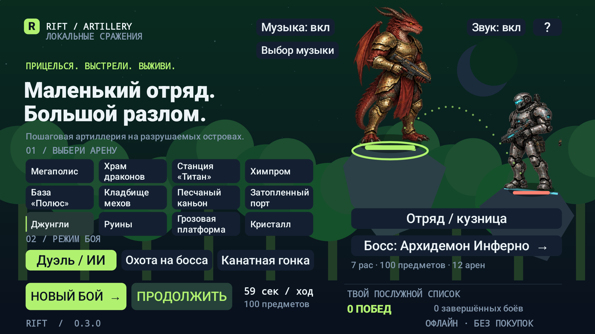
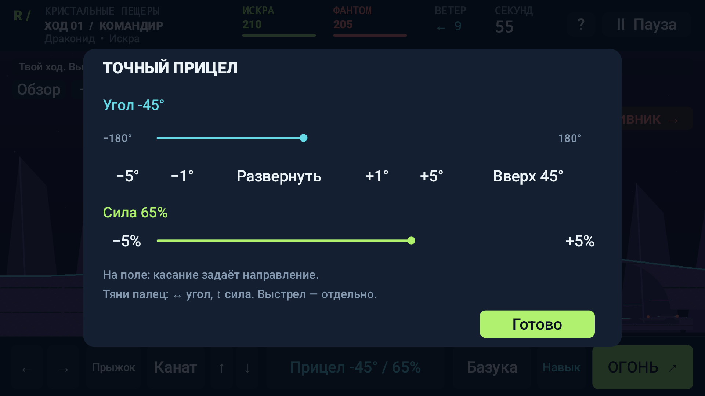
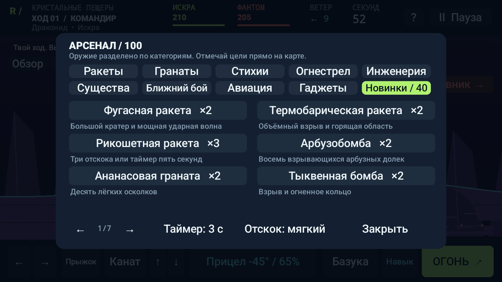
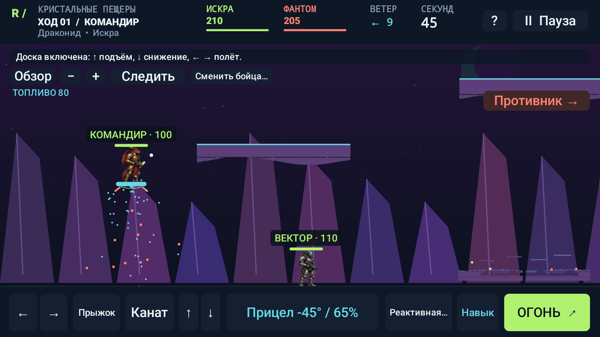
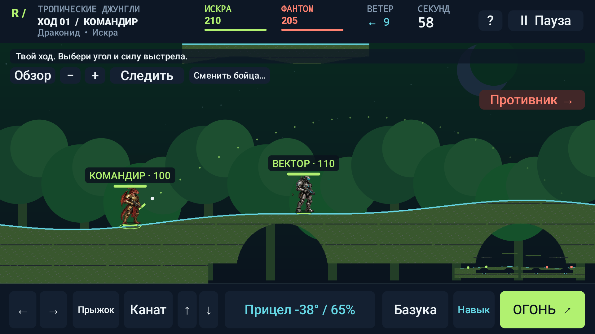
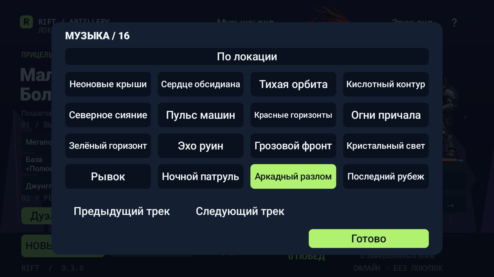
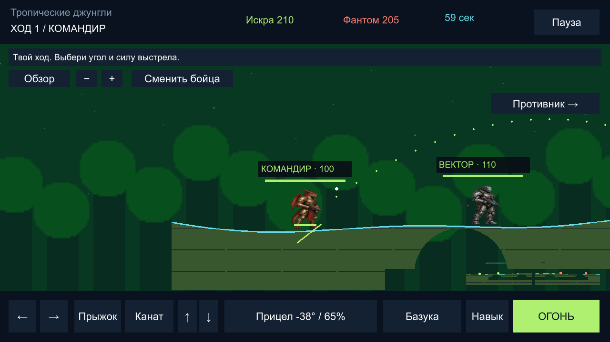

# RIFT Artillery — 0.3.0

Пошаговая артиллерия для **Android и Windows / Unity**. 12 больших разрушаемых карт, 100 видов оружия и инструментов, семь рас, четыре босса и 16 музыкальных тем. Дуэль с ИИ, игра вдвоём на одном устройстве, канатная гонка. Русский интерфейс, офлайн, без рекламы и покупок.

**[Android APK](dist/RIFT-Artillery-0.3.0.apk)** · **[Windows ZIP](dist/RIFT-Artillery-Windows-0.3.0.zip)** · [Android AAB](dist/RIFT-Artillery-0.3.0.aab) · [Unity-проект](unity) · [Каталог](docs/CONTENT.md) · [Проверки](docs/QA-0.3.0.md)



## Исправления управления

- **Ходьба не таскает соседнего бойца.** Идущий персонаж останавливается перед союзником или противником. Небольшое начальное пересечение исправляется со стороны идущего бойца.
- **Новый прицел:** крупная панель с длинными ползунками, шагом 1° и 5°, разворотом и настройкой силы. Касание поля задаёт направление; дальнейшее движение пальца по горизонтали точно меняет угол, по вертикали — силу. Выстрел выполняется отдельно.
- **Телепорт и аптечка сохраняют ход и основную атаку.** Расходуется только запас предмета, время не пополняется. Недопустимая точка и ненужное лечение не тратят предмет.
- На ход даётся **59 секунд**, после атаки — три секунды на отход. Одна бесплатная смена союзника до атаки сохраняет время. Арсенал и точный прицел приостанавливают бой.



## 100 видов оружия и инструментов

Добавлены **40 предметов**. Кнопка «Новинки / 40» в Android показывает их отдельно. В компьютерном арсенале есть поиск по названию. Параметры и запасы всех предметов — в [каталоге](docs/CONTENT.md).

| Группа | Примеры и поведение |
|---|---|
| Ракеты | Фугасная с большим кратером, термобарическая, рикошетная, буровая, трёхствольная, рой самонаводящихся и разделяющаяся ракета |
| Бомбы и гранаты | Арбузобомба с восемью дольками, ананасовая, тыквенная, осколочная с 12 зарядами, фейерверк, дымовая, ЭМИ и вампирская |
| Стихии | Коктейль Молотова, обычный и тяжёлый огнемёты, криомёт, кислотная, ледяная и огненная кассеты, цепная молния |
| Огнестрел | Миниган, дробовик, снайперка, АК-47, лазер, плазменная винтовка, рельсотрон, Гаусс, парные пистолеты, арбалет, гвоздомёт и звуковая пушка |
| Авиация | Авиаудар, напалм, метеориты, ковровая бомбардировка и объёмный авиаудар |
| Инструменты | Канат с автоподтяжкой, управляемый бур, защитник, силовой купол, балка, телепорт, ранец, парашют и реактивная доска |



**Реактивная доска** даёт 160 топлива, горизонтальный полёт, подъём, снижение и безопасную посадку. Включается до основной атаки. На Android удерживайте ↑ / ↓ и ← / →, в Windows — W / S и A / D. Доска и топливо сохраняются вместе с партией.



Бур прорезает землю в направлении прицела при удержании движения. Защитник поглощает до 40 урона и действует два перехода хода. Мины, турели, статусы, иммунитеты, экипировка и локальная кузница доступны на обеих платформах.

## 12 больших карт

Мир 2880×1440: проходимая поверхность, верхние платформы, тоннели, мосты и опасная нижняя граница. Камера поддерживает сопровождение, обзор, ручное перемещение, миникарту и масштабирование.

К мегаполису, храму драконов, орбитальной станции, химзаводу, арктической базе, кладбищу мехов, каньону и порту добавлены:

| Карта | Особенности |
|---|---|
| Тропические джунгли | Заросшие тоннели, кроны деревьев и широкие уступы |
| Забытые руины | Каменные террасы, древние своды и мост |
| Грозовая платформа | Подвесные палубы и пониженная гравитация |
| Кристальные пещеры | Светящиеся гроты и более лёгкая гравитация |



Семь рас командира: драконид, киборг, мутант, демон, наёмник, нежить и фантом. У каждой есть характеристики, иммунитеты и разовый навык. Боссы — Инферно, Алхимик, Фафнир и Генерал; три фазы, предупреждения и собственные рисунки. Генерала защищают разрушаемые генераторы.

## 16 треков и выбор музыки

«Выбор музыки» доступен в меню и на паузе. **«По локации»** включает тему карты. Можно выбрать любой трек вручную; он продолжит играть после смены локации. Есть переход к предыдущему и следующему треку, сохранение выбора и отдельное выключение музыки и эффектов.

В музыкальном окне с паузы можно прослушать композицию; закрытие окна возвращает остановленное воспроизведение. [Все темы и исходные композиции](docs/MUSIC.md).



## Отдельная компьютерная версия на Unity

Скачайте [Windows ZIP](dist/RIFT-Artillery-Windows-0.3.0.zip), **распакуйте всю папку** и запустите `RIFT-Artillery.exe`. Для готовой игры не нужно устанавливать Unity, Java или подключаться к интернету. Один EXE без остальных файлов не работает.

Unity-клиент использует ту же симуляцию, что и Android: 100 предметов, 12 карт, расы, боссы, ИИ, гонка, разрушения и сохранения. Кузница, награды и настройки хранятся локально. Формат партии общий; автоматической синхронизации между устройствами нет.



| Действие | Windows |
|---|---|
| Ходьба / прыжок | A / D, пробел |
| Направление / сила | Мышь на поле, колесо мыши |
| Выстрел | Enter или «ОГОНЬ»; для предмета с точкой — щелчок по карте |
| Канат / полёт | Q — канат, W / S — трос или тяга |
| Навык / союзник / арсенал | E / Tab / R |
| Камера / масштаб | Правая кнопка с перетаскиванием, Shift + колесо |
| Пауза | Esc |

[Открыть и собрать Unity-проект](docs/UNITY.md). Кадры Windows: [меню](docs/screenshots/v030-pc-01-menu.png), [прицел](docs/screenshots/v030-pc-03-aim.png), [поиск арбузобомбы](docs/screenshots/v030-pc-04-watermelon.png), [музыка](docs/screenshots/v030-pc-05-music.png).

## Установка Android и обновление

Android 8.0 и новее, альбомная ориентация. Откройте подписанный [APK](dist/RIFT-Artillery-0.3.0.apk). Выпуск 0.3.0 обновляет подписанную 0.2.2 с сохранением партии. Формат v4 читает v1/v2/v3; новое оружие получает начальный запас при загрузке старой партии.

Сохранённый бой хранит свою землю. **Для новой карты выберите «НОВЫЙ БОЙ».** Остаток старого хода сохраняется; новые ходы длятся 59 секунд. Версия 0.1 использовала другой сертификат и требует переустановки.

## Проверено перед финальными кадрами

**90 тестов механик, 6 тестов связи с Unity, по 165 проверок на трёх профилях Android и 162 проверки настоящего Windows-плеера.** Проверены прицел, столкновения, лечение и телепорт без потери атаки, полёт, оружие, боссы, сохранения и воспроизведение всех 16 треков. Android Lint: debug и release без замечаний.

Кадры каждой платформы сняты после проверок её сборки. [Отчёт](docs/QA-0.3.0.md), [манифест кадров](docs/screenshots/manifest-v030.json), [контрольные суммы](dist/SHA256SUMS.txt). Стабильные 60 FPS и испытания на физических телефонах не заявляются.

Галерея Android: [руины](docs/screenshots/v030-android-03-ruins.png), [гроза](docs/screenshots/v030-android-04-storm.png), [кристаллы](docs/screenshots/v030-android-05-crystal.png), [арбузобомба](docs/screenshots/v030-android-08-watermelon.png), [коктейль и огнемёты](docs/screenshots/v030-android-09-fire.png), [планшет](docs/screenshots/v030-android-12-tablet.png).

## Сборка из исходников

JDK 17, Android SDK 35 / Build Tools 34.0.0. Для Windows — Unity 6000.0.77f1 с Windows Build Support. Gradle Wrapper включён.

```powershell
. .\tools\Prepare-BuildEnvironment.ps1
.\gradlew.bat :core:test :desktop-core:test :app:assembleDebug :app:assembleDebugAndroidTest :app:lintDebug
.\tools\Test-Android.ps1 -Adb "$env:ANDROID_HOME\platform-tools\adb.exe" -Serial emulator-5558
.\tools\Build-Release.ps1
.\tools\Build-Unity.ps1 -Package
```

Подготовка окружения создаёт локальный агент совместимости Java с Windows, где недоступен AF_UNIX loopback. Он используется только для сборки, не входит в игру и хранится в игнорируемой `.tmp`.

Ключ Android и защищённый Windows-пароль остаются в локальной `.private`. Для независимого проекта новый ключ создаётся `Build-Release.ps1 -CreateLocalKey`; для обновления приложения нужен прежний ключ. Ключи и пароли не публикуются.

`core` — общая симуляция; `app` — Android Canvas; `desktop-core` — локальный движок Unity; `unity` — отдельный проект C#. [Атласы](docs/ART_ASSETS.md), [план развития](docs/PRODUCTION_PLAN.md).

Офлайн-выпуск: сетевые матчи, серверные аккаунты, онлайн-кооператив, рейтинги и редактор карт не реализованы; публикация в магазине не выполнена. Численное совпадение всех правил с Wormix не заявляется.
